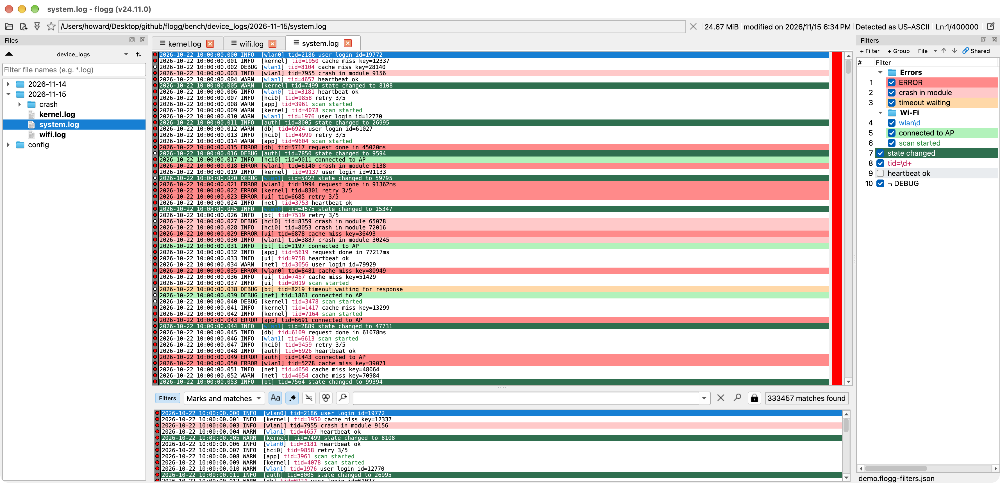
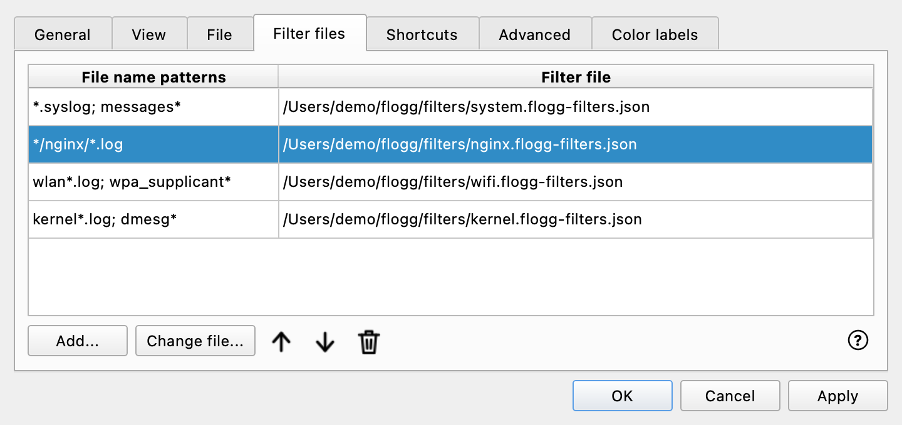
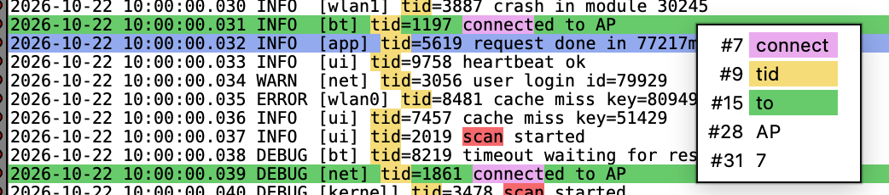

# flogg - ⚡️ A blazing fast filter-based log viewer

**English** | [繁體中文](README.zh-TW.md)

flogg is a log viewer built on [klogg](https://github.com/variar/klogg). It keeps klogg's fast file reading and search, and adds a more customisable [TextAnalysisTool (TAT)](https://textanalysistool.github.io/) style filter panel.

Downloads for Windows (x64) and Linux (x64 AppImage: `chmod +x` it and run it) are on the [releases page](https://github.com/howardgood88/flogg/releases/latest). macOS (Apple Silicon) packages are only in releases up to 1.1.0 for now.

## Features

`[TAT]`: also in TAT  
Emoji: highlights

### ✨ Filter panel: a more advanced and convenient TAT style filter manager

- Filters are organised in a tree of groups.
- 📝 Each tab has its own filters:
a newly opened file loads the filter file opened or saved last by default (see [Command line](#command-line) for where the default filter file is).
    - 🎃 `File > Preferences > Filter files` sets file name patterns that pick the filter file to load by default.  
      
    - `🔗Shared` (shared mode): lets tabs share one set of filters. Every tab in shared mode, in any window, sees a change right away, saved or not. Handy to add temporary filters without touching the saved file.
- 👑 Compatible with the TAT / klogg filter formats
    - Import TextAnalysisTool `.tat` files.
    - Import klogg predefined filters and highlighters.
- A filter or a group can be suspended to turn it off temporarily, without changing whether it is enabled.
- `[TAT]` With filters selected, `F8` / `Shift+F8` in the main or filtered view jumps between their matching lines.

### 🪧 File panel: browse a folder beside the logs and open them from there

- Open a folder with `File > Open Folder...`, by dropping it on the window or the panel, or from the command line (`flogg <folder>`).
- Open files in tabs with a double click, `Enter`, or by dragging them to the log views on the left; several files can be opened at once.
- Each window has its own folder, kept with the session; the top of the panel has the parent folder and the recent folders, and `Set as Root Folder` in the right click menu moves into a subfolder.
- 🔍 File name filter: type `*.log`, several patterns separated by spaces or `;`; a text without `*` matches a part of the name. Folders without a matching file are hidden.
- 🔎 Search and replace in a folder: `Search in Folder...` in the right click menu of a folder, or the magnifier at the top of the panel.
    - Double click a result to open the log view at its line; the right click menu opens it in edit mode instead, copies it or removes it from the results.
    - `Open as Log` opens every matching line (not only the ones listed) as `file:line:text` in a tab, to filter and view with the filters.
    - `Replace` replaces the selected results (a selected file: all of its matches), `Replace All` replaces in every file after asking. Files are written back in their encoding, BOM and line ends.
    - With a regular expression, the replacement can use `\1`. For example:
        - Search: `id=(\d+) name=(\w+)`
        - Replace: `\2:\1`
        - Result: id=12 name=alice → `alice:12`

### ✅ Main and filtered views

- 🔎 Hovering a line of the log views lists the filters matching it with their numbers, in priority order.  
  
- The selected line stands out more clearly; its colours are set in `File > Preferences > View > Style`.
- When the line selected in the main view is also a match in the filtered view, the filtered view selects it too (klogg only moved the main view along with the filtered view).
- 🕹️ `Ctrl+click` (macOS: `Cmd+click`) selects lines that do not follow each other.
- The filter panel and klogg's own search box are used one at a time; switch with the `Filters` button at the left end of the search bar above the filtered view. A new tab and an empty search start in Filter mode; turn off `Start in Filter mode` in `File > Preferences` to use the panel only as a highlighter, as in klogg.
- `Shift` + mouse wheel scrolls sideways in every view with a horizontal scroll bar.
- `[TAT]` In the main and filtered views, `Ctrl+1-5` sets bookmarks and `1-5` / `Shift+1-5` jump to the next / previous line with that bookmark.
  They also work in the filter panel, on the line selected in the filtered view (like `F8`), and the focus stays in the panel.
- The split between the main and filtered views is remembered: the last position you drag it to is used by every tab opened after, also for files opened before.
- `[TAT]` `Ctrl+H` (macOS: `Control+H`) hides the main view and shows the filtered view only.

### 🧪 Analysis: find the problem faster

- ⏱️ **Time between lines**: select two or more lines (`Ctrl+click`, `Shift+click`) and the tool bar shows the time from the first to the last one, e.g. `Δ +1.234 s`.
    - Each line is read on its own: ISO 8601 (with a zone), Android logcat, syslog, web server logs, time of day, Unix time, `[seconds since boot]`. Lines out of order or a change of format elsewhere in the file do not matter.
    - The first time stamp of the line is compared. For a line with two (`2026-11-20 05:58:25.120584,[ 2024.639186]`, the wall clock and the time since boot), right click the time and choose another one under `Time stamps compared` (the one in use is checked), for the tab; the time since boot does not jump when the clock is set. The analyses use the same choice. Lines of different formats are not compared, a line without a time stamp is told.
    - `Tools > Time Formats...` (also in the right click menu of the time) lists the formats read, with examples, and takes your own, written like `dd.MM.yyyy HH:mm:ss.f` (`yyyy`, `yy`, `MM`, `MMM`, `dd`, `HH`, `mm`, `ss`, `f` for the digits after the seconds), tried on a line of your log as you type; yours are looked for first.
    - It flashes when a new time shows (orange with `⚠`); the tool tip shows both times and their format; up to 100 000 lines between are checked in the background for the clock going back (`⚠`). The right click also copies it (`+1.234 s`) or it with the times of the lines.
- 📝 **Notes**: `Add note...` (`Shift+M`) in the right click menu of a line. The line is marked, a note sign shows beside the bookmarks, the note leads its tool tip.
    - Kept in one file of flogg (`notes.json` next to the default filter file), never next to the logs: only lines with a note, with their bookmarks. A file that no longer starts the same way, or a line that changed, loses its notes; the entry of a file goes with its last note, and only the 200 files used last are kept.
    - `Export bookmarks and notes...` writes the file name, then the lines with their numbers (`1234: ...`), each note above its line as `//` comments, ready for a bug report.
- 🔬 **`Tools > Analyze Log...`**, in the background on the log of the current tab:
    - **Durations**: a start and an end pattern, e.g. `begin request id=(\d+)` / `end request id=(\d+)`; the groups in parentheses pair the lines, an end goes with the latest start (a start never ended stays open and is listed, the pairs after it are not shifted). Mean, median, 90 and 99 percentiles, the slowest pairs and the starts never ended; a double click on the start or the end line shows that line, elsewhere it selects both.
    - **Rules** of known problems, in a JSON file shared like the filter files, written in a form: `Edit...` / `New...` list the rules and edit the one selected (kind, patterns one per line, time, count, severity, link), each checked as it is typed, `Save and Check` runs them. `Add as rule...` in the right click menu of a log view starts a rule from the selected text. `Example...` writes one rule of each kind:
      `match` (a line), `sequence` (lines in this order, within a time), `absence` (a line not followed by another within a time, e.g. a connection never established), `count` (a line repeated within a time, e.g. a retry storm). The groups in parentheses tie the lines of one case together (same connection id). The results show the kind and the severity of each rule (right click the column titles to choose the columns); a finding of several lines (a sequence, a count) opens on one row per line. The link of a rule (a runbook, a ticket, a wiki page saying what to do) opens with a double click on the rule.
    - **Compare** with another tab (pasted text too: paste it as a tab), the whole file, the filtered view or the selected lines: the lines are turned into templates (time stamps out, numbers, ids, quoted text and `key=value` values replaced) and counted: what is only in one, more or less frequent. Any two tabs can be compared. `Group lines that differ by one word` also counts as one template the lines of 4 words or more that differ by one word that is not a number (a user, a host). Or line by line (up to 100 000 lines a side), in two columns like a code review, the lines that differ in red and green.
- 🧩 **Merge files**: `Merge N Files...` in the right click menu of the file panel, or `File > Merge Files...`, writes the files one after the other into a new one and opens it. The files come in the order of the file panel and can be ordered again.

### ✏️ Edit mode: edit the file in place

- The pencil at the right of the tool bar, `View > Edit mode` or `Ctrl+Shift+E` opens the file in Scintilla (the editor of Notepad++), at the current line of the log view.
- The file is loaded in the background (1.8 GB in about 1.2 seconds) and kept in memory, about the size of the file; flogg asks first when the file is larger than half of the free memory. Leaving edit mode frees it.
- `Ctrl+S` saves in the background, in the original encoding, BOM and line ends, through a temporary file renamed over the original (the original is never left half written, permissions are kept); text that cannot be written in the original encoding is reported first.
- Undo, multiple (Ctrl) and rectangular (Alt) selection, input methods; `Ctrl+F` find and replace (Match case, regular expression, `\1` in the replacement, Replace all undone in one step), with the matches near the view highlighted in yellow.
- Leaving edit mode, closing the tab or the window asks to save; a tab with unsaved changes shows `*`; a change of the file on disk offers to reload it.
- The other modes read the file on disk and read it again after a save. Copies made by flogg (decompressed, downloaded, clipboard) and files that cannot be written are read only; use `Save as`.

### 👁️ Render mode: view the file as a document, a tree or a table

- The eye at the right of the tool bar, `View > Render mode` or `Ctrl+Shift+V` switches to it; the filter panel stays.
- Markdown and HTML are laid out close to GitHub (tables, task lists, code blocks, `> [!NOTE]` alerts, footnotes, images); `Open in browser` shows mermaid diagrams, math and syntax colouring.
- JSON (also `.har`, `.ipynb`) and XML are shown as a tree; the right click menu copies a value or its JSON path. A syntax error shows its line, and `Show in log view` goes there.
- CSV, TSV and JSON Lines are shown as a table of any size (rows are read from the log as it is scrolled, follow works too); the CSV separator is detected, the first row can be the header; `Ctrl+C` copies the selected cells.
- `Ctrl+F` find bar in documents, trees and tables, with the match count (`3 / 120`) and the matches in yellow; the count of a table is computed in the background (30 million lines in about 2 seconds).
- Files with these extensions open in render mode; others can be detected from their content, and the format can be changed in the view. Links in a document open in a flogg tab (`other.md#section` and `#L120` work), web addresses in the browser.

### ⚡️ Fast filtering: searching and filtering as fast as klogg

- Hyperscan can scan for many patterns at once, but a klogg search produces a single result; flogg extends it so that one pass over the file gives every filter its own result.
- Each filter keeps its search result in a Roaring Bitmap (as in klogg), which adapts its layout to how dense the matches are to keep memory use low.
- The final result is the union of the included filters minus the excluded ones. Enabling, disabling or suspending filters only recombines the bitmaps without rescanning, and adding or editing a filter rescans that pattern only.

### Windows

- Every start of flogg, however it is started (double click, taskbar, file association or command line), opens a new window in the same process, so the windows can share filters and the command line can target a given window (`-w`); `-m` starts a separate flogg process instead.
- 🖼️ `Window > Rename window...` gives a window a name, shown in its title instead of the file name; the `Window` menu lists every window with its id (`#2`).
- Tabs move between windows without loading the file again, and their filters go with them: drag a tab to another window, or out of every window for a new one, or use `Move to new window` / `Move to window` in the tab's right click menu.

### Updates

- Once a day at start (`Check for a new version at start` in `File > Preferences > File`), or any time with `Help > Check for updates...`.
- `Help > What's new in flogg...` lists the changes of every flogg release ([CHANGELOG.md](CHANGELOG.md)).

### Command line

- On Windows the settings (`flogg.conf`) and the default filter file are kept next to `flogg.exe`, so the whole folder is portable.
- On macOS they follow the system conventions: the settings are in `~/Library/Preferences/com.flogg.flogg.plist` and the default filter file in
  `~/Library/Application Support/flogg/filters.flogg-filters.json`; with `--config` the default filter file goes next to that settings file.
- On Linux the settings are in `~/.config/flogg/flogg.conf` and the default filter file in `~/.local/share/flogg/filters.flogg-filters.json`; `--config` works as on macOS.

- `--config <file>` reads and writes the settings in that file (any name) instead of the default `flogg.conf`; the session goes to `<name>_session.conf` next to it.
- The previous session is not restored by default. With `Load last session` in `File > Preferences`, the first flogg started without a file restores the windows (with their names), files and per tab filters open when it was closed last; `-s` / `-n` force it on or off.

Commands for the windows of a running flogg (`flogg --help` lists everything):

| Option | Effect |
| --- | --- |
| `flogg a.log b.log` | Opens the files in a new window |
| `-L`, `--list-windows` (`--json`) | Lists the windows: id, name and tabs (`*` current tab) |
| `-w`, `--window <id\|name>` | Opens the files as tabs of the given window (id like `2` or `#2`, or its name); without files the options below apply to its current tab |
| `--window-name <name>` | Names the new window, or renames the `--window` one |
| `--filters <file>` | Loads the filters of the opened tabs from that file, without making it the default one |
| `--add-filter <text>`, `--add-regex <regex>` | Adds filters to the opened tabs (can be repeated); `--filter-color <color>` gives them a background colour |
| `--shared-filters` | The opened tabs use the shared filters |
| `--line <n>` | Selects line n (from 1) in the opened tabs |
| `-f`, `--follow` | Follows the opened files |

For example `flogg -w wifi --add-regex "wlan\d" --line 1200 kernel.log` opens `kernel.log` in the window named `wifi`, adds a filter and selects line 1200. Errors (unknown window, missing file, invalid regex) are printed and nothing is done.

### Removed from klogg

Predefined filters, highlighter sets, persistent highlighting of search matches (Highlight match), Clear file, the built-in documentation and the Help menu links are replaced by the filter panel or dropped.

## Shortcuts

Shortcuts added by flogg. All of them can be changed in File > Preferences > Shortcuts.

### Views

| Action | Shortcut | Also in |
| --- | --- | --- |
| Show/hide main view | `Ctrl+H` (macOS: `Control+H`) | View menu |
| Show/hide filter panel | none by default | View and Tools menus, close button of the panel |
| Show/hide file panel | none by default | Tools menu, close button of the panel |
| Open a folder in the file panel | none by default | `File > Open Folder...`, folder menu |
| Edit mode | `Ctrl+Shift+E` | View menu, pencil in the tool bar |
| Render mode | `Ctrl+Shift+V` | View menu, eye in the tool bar |
| Analyze the log (durations, rules, compare) | none by default | `Tools > Analyze Log...` |

### File panel

These work while the file panel has the focus.

| Action | Shortcut | Mouse |
| --- | --- | --- |
| Open the selected files / expand or collapse a folder | `Enter` | Double click, drag to the log views |
| Rename | `F2` | Right click menu |
| Move to the trash | `Delete` (macOS: `Cmd+Backspace`) | Right click menu |
| Show/hide hidden files | `Ctrl+Shift+.` (macOS: `Cmd+Shift+.`) | Right click menu, folder menu |
| Sort | | `⇅` button, right click menu |
| Copy path / relative path / file name | | Right click menu |
| Merge the selected files | | Right click menu (several files), `File > Merge Files...` |
| Search and replace in the folder | none by default | Right click menu of a folder or the empty area, magnifier button, `File > Search in Folder...` |
| Find in the file (edit mode) | | Right click menu of a file |

### Filter panel

These work while the filter panel has the focus.

| Action | Shortcut | Mouse |
| --- | --- | --- |
| Add filter | `Insert` | `+ Filter` button, context menu |
| Add group | | `+ Group` button, context menu |
| Edit filter or rename group | `F2`, `Enter` | Double click |
| Delete selection | `Delete`, `Ctrl+D` (macOS: `Control+D`) | Context menu |
| Move up / down (also in and out of groups) | `Alt+Up` / `Alt+Down` | Arrow buttons, drag and drop |
| Enable / disable a filter | | Check box |
| Enable / disable (in group), enable all, disable all | | Context menu |
| Suspend / resume, suspend all / resume all | | Context menu |
| Expand all / collapse all groups | | Context menu |
| Use the shared filters | | `Shared` button |
| Add to search, exclude from search, replace search | | Context menu |
| Choose visible columns | | Right click the column header |
| Save filters | `Ctrl+S` | `File` button |
| Open, save as, import filter files | | `File` button |

### Edit mode / render mode find bar

| Action | Shortcut | Mouse |
| --- | --- | --- |
| Open the find bar | `Ctrl+F` | |
| Next / previous match | `Enter`, `F3` / `Shift+Enter`, `Shift+F3` | `↓` / `↑` buttons |
| Close the find bar | `Esc` | `✕` button |
| Replace, replace all (edit mode) | `Enter` in the replace box | `Replace` / `Replace all` buttons |

### Log views

| Action | Shortcut | Mouse |
| --- | --- | --- |
| Next match of the selected filters (wraps around) | `F8` | Filter panel context menu |
| Previous match of the selected filters (wraps around) | `Shift+F8` | Filter panel context menu |
| Set/remove bookmark N (1-5) on the selected lines | `Ctrl+1` ... `Ctrl+5` | |
| Next line with bookmark N | `1` ... `5` | |
| Previous line with bookmark N | `Shift+1` ... `Shift+5` (`!` ... `%`) | |
| Highlight the selection with color N (1-9) | `Alt+1` ... `Alt+9` | |
| Add or edit the note of the line | `Shift+M` | `Add note...` in the right click menu |
| Time between the first and last selected lines | | Select with `Ctrl+click` or `Shift+click`, shown in the tool bar |
| Add selection (or the whole line) as filter | `Shift+F` | `Add as filter...` in the log view context menu |
| Add search text as filter | | `Add as filter...` in the search box context menu |

## Building

flogg builds the same way as klogg, see [BUILD.md](BUILD.md). The CI build is in
[.github/workflows/flogg-build.yml](.github/workflows/flogg-build.yml), and
[bench/README.md](bench/README.md) describes the benchmark log generator.

## Credits and license

flogg is a fork of [klogg](https://github.com/variar/klogg) by Anton Filimonov,
which started as a fork of [glogg](https://github.com/nickbnf/glogg) by Nicolas
Bonnefon. All of the log reading, search engine and most of the UI come from
klogg; see the klogg repository for its documentation and history.

Licensed under the GPLv3 or later, see [COPYING](COPYING).
