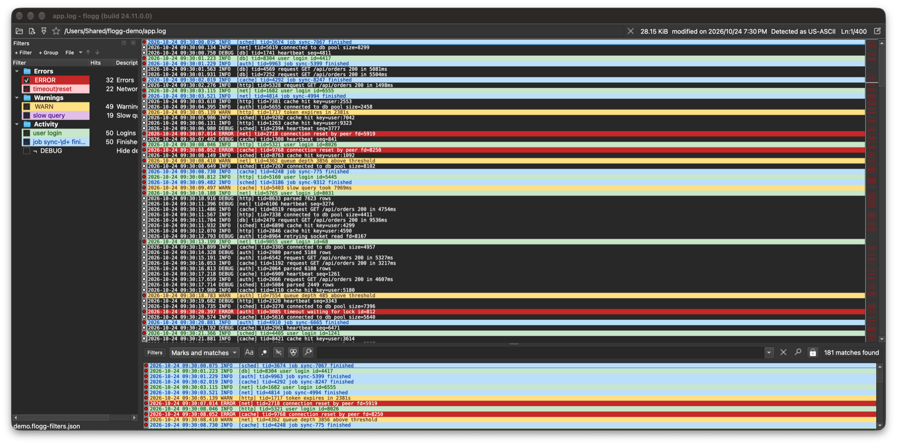

# flogg

**English** | [繁體中文](README.zh-TW.md)

flogg is a log viewer built on [klogg](https://github.com/variar/klogg). It keeps
klogg's fast file reading and search, and replaces its search bar workflow with a
[TextAnalysisTool](https://textanalysistool.github.io/) style filter panel: a list
of filters that decides both which lines appear in the filtered view and how the
main view is coloured.

Downloads for Windows (x64) and macOS (Apple Silicon) are on the
[releases page](https://github.com/howardgood88/flogg/releases/latest).

## Features

### Filter panel

- Filters are organised in a tree of nested groups.
- Each filter has a pattern (plain text or regular expression), case sensitivity,
  an exclude option, and foreground/background colours applied to the whole line
  or to the match only.
- The enabled filters drive both the filtered view and the colouring of the main
  view.
- Enable or disable single filters, whole groups, or everything at once; suspend a
  filter temporarily without losing its state.
- Filters can have multi-line descriptions (first line in the list, all of it in
  the tool tip).
- Reorder filters with drag and drop or the move buttons, including moving them in
  and out of groups.
- Columns resize independently; their widths and visibility are saved. Right click
  the header to choose the visible columns.
- Create a filter from the selected text or from the search box.
- The hits column shows the number of matching lines of each filter; a group shows
  the sum of its enabled filters.
- Every filter has a number following its priority (the `#` column, which can be hidden
  like the other columns); hovering a line of the log views lists the filters matching
  it with their numbers, in priority order.
- A `Light` style (Preferences > View > Style) keeps flogg light whatever the system
  appearance; `Dark` keeps it dark.

### Fast filtering

- Each filter keeps its own result bitmap, so toggling filters only recombines
  cached results and editing a filter rescans that pattern only.
- Larger read blocks and no sleep polling in the search pipeline.

### Bookmarks and views

- Numbered bookmarks 1-8 on any number of lines, with next/previous navigation per
  bookmark. The bookmark column is only shown while the file has bookmarks.
- Hide the main log view to give the filtered view the whole window.
- All new actions have configurable shortcuts, see [Shortcuts](#shortcuts).

### Filter files

- Filters are saved as JSON filter files (File menu of the filter panel).
- Import TextAnalysisTool `.tat` files.
- Import klogg predefined filters and highlighters.

### Command line

- `--config <file>` keeps the settings in that file (and the session in
  `<name>_session.conf` next to it).
- `--filters <file>` loads a filter file without making it the default one.
- Together with `-m` this starts several windows, each with its own settings and
  filters.
- On Windows the settings and the default filter file are kept next to
  `flogg.exe`, so the package is portable.

### Removed from klogg

Predefined filters, highlighter sets, search highlighting, clear file, the version
check and the Help menu links are replaced by the filter panel or dropped.

## Shortcuts

Shortcuts added by flogg. All of them can be changed in Preferences > Shortcuts.
On macOS, `Ctrl` is the Command key and `Alt` is the Option key, except for
Show/hide main log view, which uses the Control key (Command+H hides the
application).

### Views

| Action | Shortcut | Also in |
| --- | --- | --- |
| Show/hide main log view | `Ctrl+H` (macOS: `Control+H`) | View menu |
| Show/hide filter panel | none by default | View and Tools menus, close button of the panel |

### Filter panel

These work while the filter panel has the focus.

| Action | Shortcut | Mouse |
| --- | --- | --- |
| Add filter | `Insert` | `+ Filter` button, context menu |
| Add group | | `+ Group` button, context menu |
| Edit filter or rename group | `F2`, `Enter` | Double click |
| Delete selection | `Delete` | Context menu |
| Move up / down (also in and out of groups) | `Alt+Up` / `Alt+Down` | Arrow buttons, drag and drop |
| Enable / disable a filter | | Check box |
| Enable / disable (in group), enable all, disable all | | Context menu |
| Suspend / resume, suspend all / resume all | | Context menu |
| Add to search, exclude from search, replace search | | Context menu |
| Choose visible columns | | Right click the column header |
| Open, save, import filter files | | `File` button |

### Log views

| Action | Shortcut | Mouse |
| --- | --- | --- |
| Next match of the selected filters (wraps around) | `F8` | Filter panel context menu |
| Previous match of the selected filters (wraps around) | `Shift+F8` | Filter panel context menu |
| Set/remove bookmark N (1-8) on the selected lines | `Ctrl+1` ... `Ctrl+8` | |
| Next line with bookmark N | `Alt+1` ... `Alt+8` | |
| Previous line with bookmark N | `Alt+Shift+1` ... `Alt+Shift+8` | |
| Add selection as filter | none by default | `Add as filter...` in the log view context menu |
| Add search text as filter | | `Add as filter...` in the search box context menu |

## Building

flogg builds the same way as klogg, see [BUILD.md](BUILD.md). The CI build is in
[.github/workflows/flogg-build.yml](.github/workflows/flogg-build.yml), and
[bench/README.md](bench/README.md) describes the benchmark log generator.

## Credits and license

flogg is a fork of [klogg](https://github.com/variar/klogg) by Anton Filimonov,
which started as a fork of [glogg](https://github.com/nickbnf/glogg) by Nicolas
Bonnefon. All of the log reading, search engine and most of the UI come from
klogg; see the klogg repository for its documentation and history.

Licensed under the GPLv3 or later, see [COPYING](COPYING).
