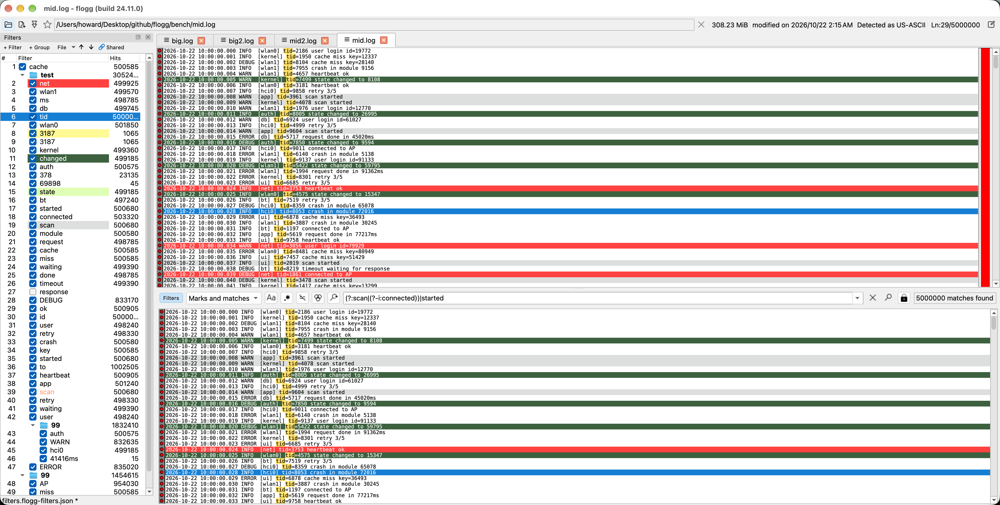
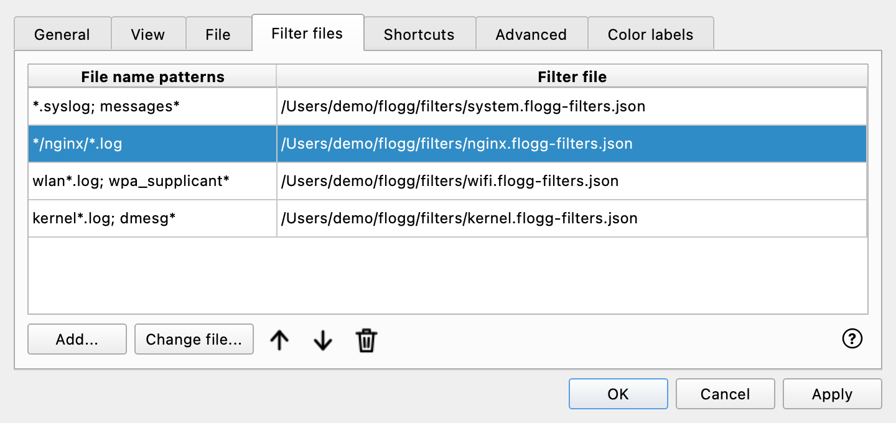
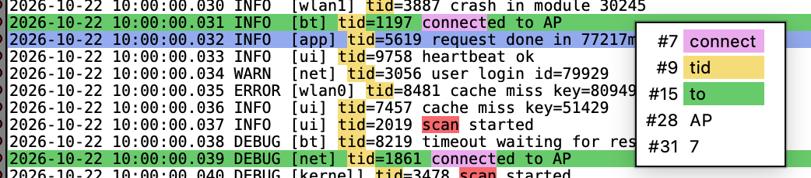

# flogg - ⚡️ A blazing fast filter-based log viewer

**English** | [繁體中文](README.zh-TW.md)

flogg is a log viewer built on [klogg](https://github.com/variar/klogg). It keeps klogg's fast file reading and search, and adds a more customisable [TextAnalysisTool (TAT)](https://textanalysistool.github.io/) style filter panel.

Downloads for Windows (x64) and Linux (x64 AppImage: `chmod +x` it and run it) are on the [releases page](https://github.com/howardgood88/flogg/releases/latest). macOS (Apple Silicon) packages are only in releases up to 1.1.0 for now.

## Features

`[TAT]`: also in TAT  
Emoji: highlights

### ✨ Filter panel: a more advanced and convenient TAT style filter manager

- Filters are organised in a tree of groups.
- 📝 Each tab has its own filters:
a newly opened file loads the filter file opened or saved last by default (see [Command line](#command-line) for where the default filter file is).
    - 🎃 `File > Preferences > Filter files` sets file name patterns that pick the filter file to load by default.  
      
    - `🔗Shared` (shared mode): lets tabs share one set of filters. Every tab in shared mode, in any window, sees a change right away, saved or not. Handy to add temporary filters without touching the saved file.
- 👑 Compatible with the TAT / klogg filter formats
    - Import TextAnalysisTool `.tat` files.
    - Import klogg predefined filters and highlighters.
- A filter or a group can be suspended to turn it off temporarily, without changing whether it is enabled.
- `[TAT]` With filters selected, `F8` / `Shift+F8` in the main or filtered view jumps between their matching lines.

### ✅ Main and filtered views

- 🔎 Hovering a line of the log views lists the filters matching it with their numbers, in priority order.  
  
- The selected line stands out more clearly; its colours are set in `File > Preferences > View > Style`.
- When the line selected in the main view is also a match in the filtered view, the filtered view selects it too (klogg only moved the main view along with the filtered view).
- 🕹️ `Ctrl+click` (macOS: `Cmd+click`) selects lines that do not follow each other.
- The filter panel and klogg's own search box are used one at a time; switch with the `Filters` button at the left end of the search bar above the filtered view. A new tab and an empty search start in Filter mode; turn off `Start in Filter mode` in `File > Preferences` to use the panel only as a highlighter, as in klogg.
- `Shift` + mouse wheel scrolls sideways in every view with a horizontal scroll bar.
- `[TAT]` In the main and filtered views, `Ctrl+1-8` sets bookmarks and `Alt+1-8` / `Shift+Alt+1-8` jump to the next / previous line with that bookmark.
  They also work in the filter panel, on the line selected in the filtered view (like `F8`), and the focus stays in the panel.
  (Changing them in `File > Preferences > Shortcuts` is recommended; flogg keeps klogg's own shortcuts by default.)
- The split between the main and filtered views is remembered: the last position you drag it to is used by every tab opened after, also for files opened before.
- `[TAT]` `Ctrl+H` (macOS: `Control+H`) hides the main view and shows the filtered view only.

### ⚡️ Fast filtering: searching and filtering as fast as klogg

- Hyperscan can scan for many patterns at once, but a klogg search produces a single result; flogg extends it so that one pass over the file gives every filter its own result.
- Each filter keeps its search result in a Roaring Bitmap (as in klogg), which adapts its layout to how dense the matches are to keep memory use low.
- The final result is the union of the included filters minus the excluded ones. Enabling, disabling or suspending filters only recombines the bitmaps without rescanning, and adding or editing a filter rescans that pattern only.

### Windows

- Every start of flogg, however it is started (double click, taskbar, file association or command line), opens a new window in the same process, so the windows can share filters and the command line can target a given window (`-w`); `-m` starts a separate flogg process instead.
- 🖼️ `Window > Rename window...` gives a window a name, shown in its title instead of the file name; the `Window` menu lists every window with its id (`#2`).

### Updates

- Once a day at start (`Check for a new version at start` in `File > Preferences > File`), or any time with `Help > Check for updates...`.
- `Help > What's new in flogg...` lists the changes of every flogg release ([CHANGELOG.md](CHANGELOG.md)).

### Command line

- On Windows the settings (`flogg.conf`) and the default filter file are kept next to `flogg.exe`, so the whole folder is portable.
- On macOS they follow the system conventions: the settings are in `~/Library/Preferences/com.flogg.flogg.plist` and the default filter file in
  `~/Library/Application Support/flogg/filters.flogg-filters.json`; with `--config` the default filter file goes next to that settings file.
- On Linux the settings are in `~/.config/flogg/flogg.conf` and the default filter file in `~/.local/share/flogg/filters.flogg-filters.json`; `--config` works as on macOS.

- `--config <file>` reads and writes the settings in that file (any name) instead of the default `flogg.conf`; the session goes to `<name>_session.conf` next to it.
- The previous session is not restored by default. With `Load last session` in `File > Preferences`, the first flogg started without a file restores the windows (with their names), files and per tab filters open when it was closed last; `-s` / `-n` force it on or off.

Commands for the windows of a running flogg (`flogg --help` lists everything):

| Option | Effect |
| --- | --- |
| `flogg a.log b.log` | Opens the files in a new window |
| `-L`, `--list-windows` (`--json`) | Lists the windows: id, name and tabs (`*` current tab) |
| `-w`, `--window <id\|name>` | Opens the files as tabs of the given window (id like `2` or `#2`, or its name); without files the options below apply to its current tab |
| `--window-name <name>` | Names the new window, or renames the `--window` one |
| `--filters <file>` | Loads the filters of the opened tabs from that file, without making it the default one |
| `--add-filter <text>`, `--add-regex <regex>` | Adds filters to the opened tabs (can be repeated); `--filter-color <color>` gives them a background colour |
| `--shared-filters` | The opened tabs use the shared filters |
| `--line <n>` | Selects line n (from 1) in the opened tabs |
| `-f`, `--follow` | Follows the opened files |

For example `flogg -w wifi --add-regex "wlan\d" --line 1200 kernel.log` opens `kernel.log` in the window named `wifi`, adds a filter and selects line 1200. Errors (unknown window, missing file, invalid regex) are printed and nothing is done.

### Removed from klogg

Predefined filters, highlighter sets, persistent highlighting of search matches (Highlight match), Clear file, the built-in documentation and the Help menu links are replaced by the filter panel or dropped.

## Shortcuts

Shortcuts added by flogg. All of them can be changed in File > Preferences > Shortcuts.

### Views

| Action | Shortcut | Also in |
| --- | --- | --- |
| Show/hide main view | `Ctrl+H` (macOS: `Control+H`) | View menu |
| Show/hide filter panel | none by default | View and Tools menus, close button of the panel |

### Filter panel

These work while the filter panel has the focus.

| Action | Shortcut | Mouse |
| --- | --- | --- |
| Add filter | `Insert` | `+ Filter` button, context menu |
| Add group | | `+ Group` button, context menu |
| Edit filter or rename group | `F2`, `Enter` | Double click |
| Delete selection | `Delete` | Context menu |
| Move up / down (also in and out of groups) | `Alt+Up` / `Alt+Down` | Arrow buttons, drag and drop |
| Enable / disable a filter | | Check box |
| Enable / disable (in group), enable all, disable all | | Context menu |
| Suspend / resume, suspend all / resume all | | Context menu |
| Expand all / collapse all groups | | Context menu |
| Use the shared filters | | `Shared` button |
| Add to search, exclude from search, replace search | | Context menu |
| Choose visible columns | | Right click the column header |
| Save filters | `Ctrl+S` | `File` button |
| Open, save as, import filter files | | `File` button |

### Log views

| Action | Shortcut | Mouse |
| --- | --- | --- |
| Next match of the selected filters (wraps around) | `F8` | Filter panel context menu |
| Previous match of the selected filters (wraps around) | `Shift+F8` | Filter panel context menu |
| Set/remove bookmark N (1-8) on the selected lines | `Ctrl+1` ... `Ctrl+8` | |
| Next line with bookmark N | `Alt+1` ... `Alt+8` | |
| Previous line with bookmark N | `Alt+Shift+1` ... `Alt+Shift+8` | |
| Add selection (or the whole line) as filter | none by default | `Add as filter...` in the log view context menu |
| Add search text as filter | | `Add as filter...` in the search box context menu |

## Building

flogg builds the same way as klogg, see [BUILD.md](BUILD.md). The CI build is in
[.github/workflows/flogg-build.yml](.github/workflows/flogg-build.yml), and
[bench/README.md](bench/README.md) describes the benchmark log generator.

## Credits and license

flogg is a fork of [klogg](https://github.com/variar/klogg) by Anton Filimonov,
which started as a fork of [glogg](https://github.com/nickbnf/glogg) by Nicolas
Bonnefon. All of the log reading, search engine and most of the UI come from
klogg; see the klogg repository for its documentation and history.

Licensed under the GPLv3 or later, see [COPYING](COPYING).
