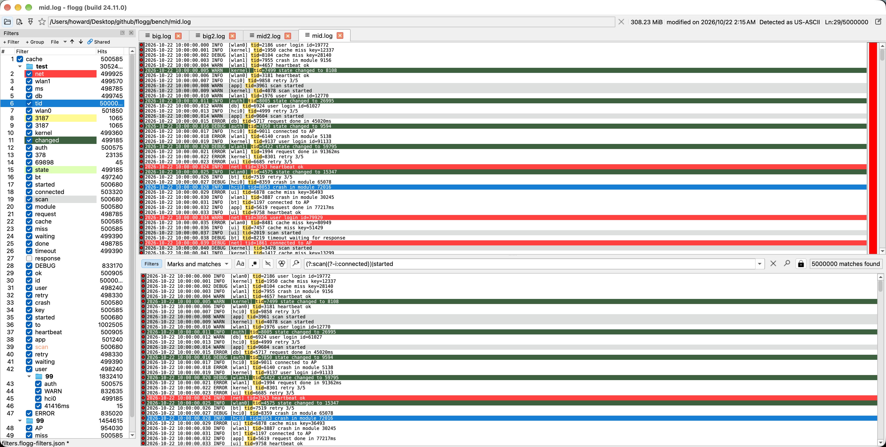

# flogg

[English](README.md) | **繁體中文**

flogg 是以 [klogg](https://github.com/variar/klogg) 為基礎的 log 檢視器，保留了 klogg 快速的檔案讀取與搜尋，並加入客製化程度更高的 [TextAnalysisTool (TAT)](https://textanalysistool.github.io/) 風格 filter panel。

Windows（x64）與 Linux（x64 AppImage，`chmod +x` 後直接執行）的安裝檔請到 [Releases 頁面](https://github.com/howardgood88/flogg/releases/latest)下載。macOS（Apple Silicon）安裝檔目前只有 1.1.0 以前的版本。

## 功能

### Filter panel：更進階且方便的 TAT 風格 filter 管理面板

- 支援樹狀群組管理。
- 每個分頁各自保存 filter：清單、啟用／停用／暫停狀態，以及使用的 JSON filter 檔。新開的檔案載入預設 filter 檔，即 `filters.flogg-filters.json` 或最近一次開啟／另存的 filter 檔（位置見下方[命令列](#命令列)）。
- `File > Preferences > Filter files` 可依檔名 pattern指定要讀取的 filter 檔。由上往下比對，第一個符合的生效。不符合的檔案照上述方式載入預設 filter 檔。
- 兼容 TAT / klogg filter 格式
    - 支援匯入 TextAnalysisTool 的 `.tat` 檔。
    - 支援匯入 klogg 的 predefined filters 與 highlighters。
- 支援 suspend 使其暫時失效（不會改動原本的啟用狀態）。
- 選中 filter 後，在主視窗或過濾視窗按 `F8` / `Shift+F8` 在命中行間跳轉。
- `🔗Shared （共用模式）`：
   - 讓不同分頁共用一個 filter，所有開啟 `共用模式` 的分頁（不論在哪個視窗），不論修改是否已儲存，都會立即同步到同在 `共用模式` 的其他分頁。
   - 第一個開啟 `共用模式` 的分頁會複製自己的 filter 作為共用 filter；共用 filter 第一次被修改時會變成 untitled，存檔時會詢問檔名，不會覆蓋該分頁原本的 filter 檔。離開 `共用模式` 後恢復該分頁自己的 filter。當最後一個分頁離開 `共用模式` 時會清除共用模式的資訊。

### 主視窗 / 過濾視窗優化

- 滑鼠停在 log 檢視的某一行時，會依優先順序列出命中該行的 filter 與其編號。
- 優化選中行的視覺顯示使其更顯眼
- 若主視窗選中行在過濾視窗有對應命中行，過濾視窗的選中行也會跳轉（原本只有過濾視窗會使主視窗跳轉）
- `Ctrl+左鍵`（macOS：`Cmd+左鍵`）可選取不連續的多行。
- Filter Panel 與 klogg 原生 pattern 輸入框互斥，可透過過濾視窗上方搜尋列最左邊的 `Filters` 按鈕切換。新分頁與空白搜尋預設進入 Filter mode；在 `File > Preferences` 關閉 `Start in Filter mode` 後，filter panel 就只負責標色，使用方式接近 klogg。
- 所有有橫向捲軸的畫面都支援 `Shift` + 滑鼠滾輪橫向捲動。
- 主視窗與過濾視窗支援 `Ctrl+1-8` 標記書籤，`Alt+1-8` / `Shift+Alt+1-8` 可跳到下一個 / 上一個對應書籤行。
  (建議至 `File > Preferences > Shortcuts` 修改按鍵設定，flogg 預設保留 klogg 原生 shortcuts)
- `Ctrl+H`（macOS：`Control+H`）可隱藏主視窗，只顯示過濾視窗。

### 快速過濾：與 klogg 同樣高效的搜尋與過濾

- Hyperscan 本身即支援多 pattern 同時掃描，但 klogg 一次搜尋只產生一份結果；flogg 將其擴充為掃描一次檔案就同時得到每個 filter 各自的結果。
- 每個 filter 維護自己的搜尋結果 Roaring Bitmap（沿用自 klogg），可自動根據命中稠密度調整資料結構，以壓縮所需記憶體空間。
- 最終命中結果為 Roaring Bitmap 彼此做聯集 / 差集，啟用 / 停用 / 暫停 filter 只需重新計算 bitmap 組合結果，不需要重新掃描，新增 / 編輯 filter 也只會重新掃描該 pattern。

### 視窗

- 不論以何種方式啟動（雙擊、工作列、檔案關聯、命令列），每次啟動都會以同 process 開一個新視窗，可以共用 filter，也可以從命令列指定特定視窗 (`-w`)；`-m` 則會另外啟動一個獨立 process 的 flogg。
- `Window > Rename window...` 可為視窗命名，標題會顯示這個名稱而不是檔名；`Window` 選單會列出所有視窗及其 id（`#2`）。

### 更新

- 每天啟動時檢查一次（`File > Preferences > File` 的 `Check for a new version at start`），或用 `Help > Check for updates...` 隨時檢查。GitHub 上有新版時，會顯示更新內容，可選擇立即更新、略過此版本或稍後再說。
- `Help > What's new in flogg...` 列出 flogg 每個版本的改動（[CHANGELOG.md](CHANGELOG.md)）。

### 命令列

- Windows 版的設定（`flogg.conf`）與預設 filter 檔放在 `flogg.exe` 旁邊，整個資料夾為 portable。
- macOS 版依照系統慣例存放：設定在 `~/Library/Preferences/com.flogg.flogg.plist`，預設 filter 檔在
  `~/Library/Application Support/flogg/filters.flogg-filters.json`；使用 `--config` 時，預設 filter 檔改放在該設定檔旁邊。
- Linux 版的設定在 `~/.config/flogg/flogg.conf`，預設 filter 檔在 `~/.local/share/flogg/filters.flogg-filters.json`；`--config` 的行為與 macOS 相同。

- `--config <file>`：改用指定的設定檔讀寫設定，不影響預設的 `flogg.conf`；對應 session 存在同目錄的 `<name>_session.conf`。
- 預設不恢復上次的 session。在 `File > Preferences` 勾選 `Load last session` 後，第一個不帶檔案啟動的 flogg 會恢復上次關閉時的視窗（含名稱）、檔案與各分頁的 filter；`-s`／`-n` 可強制開啟或關閉。

操作執行中 flogg 視窗的指令（完整清單見 `flogg --help`）：

| 選項 | 作用 |
| --- | --- |
| `flogg a.log b.log` | 在新視窗開啟這些檔案 |
| `-L`、`--list-windows`（`--json`） | 列出所有視窗：id、名稱與分頁（`*` 為目前分頁） |
| `-w`、`--window <id\|name>` | 指定視窗以分頁開啟檔案（id 如 `2` 或 `#2`，或視窗名稱）；不帶檔案時，下列選項套用到它目前的分頁 |
| `--window-name <name>` | 為新視窗命名，或為 `--window` 指定的視窗改名 |
| `--filters <file>` | 開啟的分頁從該檔案載入 filter，但不設為預設 filter 檔 |
| `--add-filter <text>`、`--add-regex <regex>` | 為開啟的分頁新增 filter（可重複）；`--filter-color <color>` 設定其背景色 |
| `--shared-filters` | 開啟的分頁使用共用 filter |
| `--line <n>` | 在開啟的分頁選取第 n 行（從 1 起算） |
| `-f`、`--follow` | Follow 開啟的檔案 |

例如 `flogg -w wifi --add-regex "wlan\d" --line 1200 kernel.log` 會在名為 `wifi` 的視窗開啟 `kernel.log`、新增一個 filter 並選取第 1200 行。發生錯誤（找不到視窗、檔案不存在、regex 無效）時會印出訊息，且不做任何動作。

### 相較 klogg 移除的功能

Predefined filters、highlighter sets、常駐搜尋結果高亮(highlight match)、清空檔案(clear file)、內建說明文件與 Help 選單連結，已由 filter panel 取代或移除。

## 快捷鍵

以下是 flogg 新增的快捷鍵，全部都可以在 File > Preferences > Shortcuts 中修改。

### 檢視

| 操作 | 快捷鍵 | 其他位置 |
| --- | --- | --- |
| 顯示／隱藏主視窗檢視 | `Ctrl+H`（macOS：`Control+H`） | View 選單 |
| 顯示／隱藏 filter panel | 預設無 | View 與 Tools 選單、panel 右上角的關閉按鈕 |

### Filter panel

以下快捷鍵在 filter panel 取得焦點時有效。

| 操作 | 快捷鍵 | 滑鼠 |
| --- | --- | --- |
| 新增 filter | `Insert` | `+ Filter` 按鈕、右鍵選單 |
| 新增群組 | | `+ Group` 按鈕、右鍵選單 |
| 編輯 filter／重新命名群組 | `F2`、`Enter` | 雙擊 |
| 刪除選取項目 | `Delete` | 右鍵選單 |
| 上移／下移（也可移入、移出群組） | `Alt+Up`／`Alt+Down` | 箭頭按鈕、拖放 |
| 啟用／停用單一 filter | | 勾選框 |
| 啟用／停用（群組內）、全部啟用、全部停用 | | 右鍵選單 |
| Suspend／Resume、全部 Suspend／全部 Resume | | 右鍵選單 |
| 全部展開／全部收起群組 | | 右鍵選單 |
| 使用共用 filter | | `Shared` 按鈕 |
| 加入搜尋、從搜尋排除、取代搜尋 | | 右鍵選單 |
| 選擇要顯示的欄位 | | 在欄位標題按右鍵 |
| 儲存 filter | `Ctrl+S` | `File` 按鈕 |
| 開啟、另存、匯入 filter 檔 | | `File` 按鈕 |

### Log 檢視

| 操作 | 快捷鍵 | 滑鼠 |
| --- | --- | --- |
| 跳到選取 filter 的下一個符合行（循環搜尋） | `F8` | Filter panel 右鍵選單 |
| 跳到選取 filter 的上一個符合行（循環搜尋） | `Shift+F8` | Filter panel 右鍵選單 |
| 在選取的行設定／移除書籤 N（1-8） | `Ctrl+1` … `Ctrl+8` | |
| 跳到下一個有書籤 N 的行 | `Alt+1` … `Alt+8` | |
| 跳到上一個有書籤 N 的行 | `Alt+Shift+1` … `Alt+Shift+8` | |
| 將選取文字（未選取時為整行）加為 filter | 預設無 | Log 檢視右鍵選單的 `Add as filter...` |
| 將搜尋文字加為 filter | | 搜尋框右鍵選單的 `Add as filter...` |

## 建置

flogg 的建置方式與 klogg 相同，請見 [BUILD.md](BUILD.md)。CI 建置設定在
[.github/workflows/flogg-build.yml](.github/workflows/flogg-build.yml)，
[bench/README.md](bench/README.md) 說明效能測試用的 log 產生器。

## 致謝與授權

flogg fork 自 Anton Filimonov 的 [klogg](https://github.com/variar/klogg)，而 klogg
最初 fork 自 Nicolas Bonnefon 的 [glogg](https://github.com/nickbnf/glogg)。log 讀取、
搜尋引擎與大部分 UI 都來自 klogg，相關文件與歷史請參考 klogg 的 repository。

採用 GPLv3 或更新版本授權，見 [COPYING](COPYING)。
