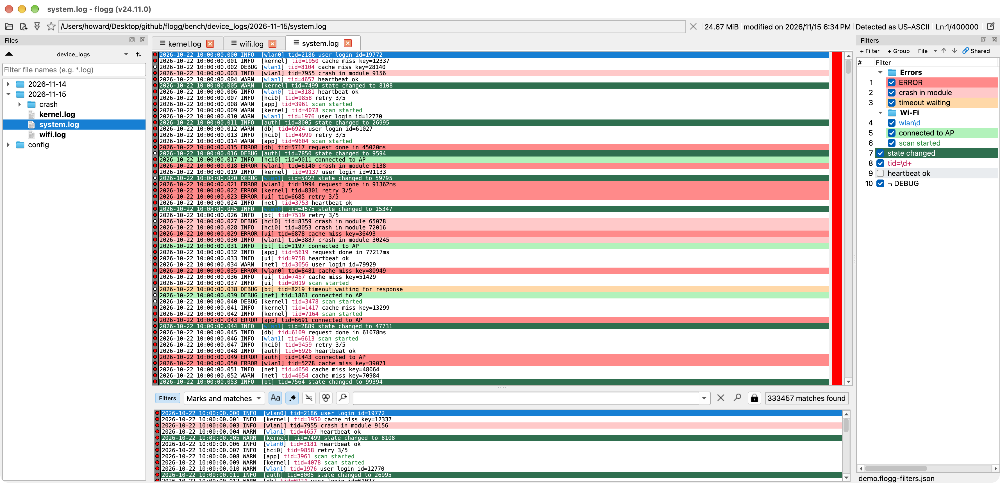
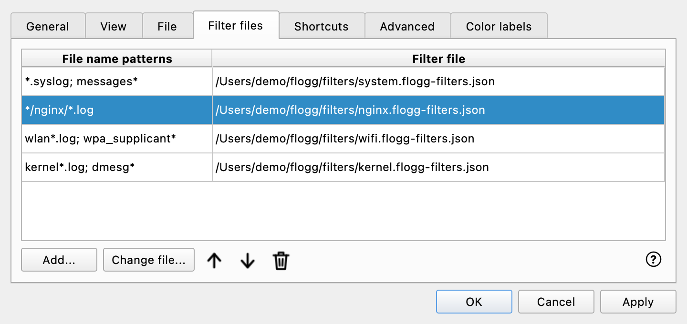
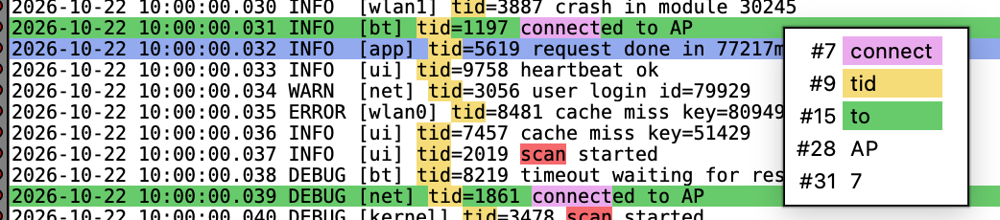

# flogg - ⚡️ 極速的 filter-based log 瀏覽器

[English](README.md) | **繁體中文**

flogg 是以 [klogg](https://github.com/variar/klogg) 為基礎的 log 檢視器，保留了 klogg 快速的檔案讀取與搜尋，並加入客製化程度更高的 [TextAnalysisTool (TAT)](https://textanalysistool.github.io/) 風格 filter panel。

Windows（x64）與 Linux（x64 AppImage，`chmod +x` 後直接執行）的安裝檔請到 [Releases 頁面](https://github.com/howardgood88/flogg/releases/latest)下載。macOS（Apple Silicon）安裝檔目前只有 1.1.0 以前的版本。

## 功能

`[TAT]`：TAT 支援的功能  
Emoji：亮點功能

### ✨ Filter panel：更進階且方便的 TAT 風格 filter 管理面板

- 支援樹狀群組 (group) 管理。
- 📝 每個分頁各自保存 filter：
新開的檔案預設載入最近一次開啟／另存的 filter 檔（預設 filter 檔路徑位置見下方[命令列](#命令列)）。
    - 🎃 `File > Preferences > Filter files` 可設定檔名 pattern 指定預設要讀取的 filter 檔。  
      
    - `🔗Shared （共用模式）`：讓不同分頁共用一個 filter。所有開啟 `共用模式` 的分頁（不論在哪個視窗），不論修改是否已儲存，改動都會立即同步。多用於想新增暫時性的 filter 又不想汙染存檔時。
- 👑 兼容 TAT / klogg filter 格式
    - 支援匯入 TextAnalysisTool 的 `.tat` 檔。
    - 支援匯入 klogg 的 predefined filters 與 highlighters。
- 支援 suspend 使 filter / group 暫時失效（不會改動原本的啟用狀態）。
- `[TAT]`選中 filter 後，在主視窗或過濾視窗按 `F8` / `Shift+F8` 在命中行間跳轉。

### 🪧 File panel：在視窗旁瀏覽資料夾，直接開 log

- 用 `File > Open Folder...` 開啟資料夾，或把資料夾拖到視窗或 panel 上；也可以從命令列傳入資料夾（`flogg <folder>`）。
- 雙擊、`Enter` 或拖到左邊的 log 檢視區開啟檔案，可一次選多個檔案開啟。
- 每個視窗各自有一個資料夾，會跟 session 一起保存；panel 上方有上一層資料夾與最近開過的資料夾，右鍵 `Set as Root Folder` 可切換到子資料夾。
- 🔍 檔名過濾：輸入 `*.log`，多個 pattern 用空白或 `;` 隔開；沒有 `*` 的文字會比對檔名的一部分。沒有符合檔案的資料夾會被隱藏。
- 🔎 資料夾搜尋與取代：在資料夾、panel 上方的放大鏡按右鍵 `Search in Folder...`。
    - 雙擊結果在 log 檢視開到該行；右鍵可改用 edit mode 開啟、複製或從結果中移除。
    - `Open as Log` 把所有命中行（不只畫面上列出的）以 `檔案:行號:內容` 的格式開成一個分頁，可以用 filter 進一步過濾與檢視。
    - `Replace` 取代選取的結果（選檔案即取代該檔全部），`Replace All` 確認後取代所有檔案。檔案以原編碼、BOM 與換行寫回。
    - regular expression 可在取代字串用 `\1`。例如：
        - 搜尋：`id=(\d+) name=(\w+)`
        - 取代：`\2:\1`
        - 結果：假設 id=12 name=alice → `alice:12`

### ✅ 主視窗 / 過濾視窗優化

- 🔎 滑鼠停在 log 檢視的某一行時，會依優先順序列出命中該行的 filter 與其編號。  
  
- 優化選中行的視覺顯示使其更顯眼，可於 `File > Preferences > View > Style` 調整選取顏色。
- 若主視窗選中行在過濾視窗有對應命中行，過濾視窗的選中行也會跳轉（原本只有過濾視窗會使主視窗跳轉）
- 🕹️ `Ctrl+左鍵`（macOS：`Cmd+左鍵`）可選取不連續的多行。
- Filter Panel 與 klogg 原生 pattern 輸入框互斥，可透過過濾視窗上方搜尋列最左邊的 `Filters` 按鈕切換。新分頁與空白搜尋預設進入 Filter mode；在 `File > Preferences` 關閉 `Start in Filter mode` 後，filter panel 就只負責標色，使用方式接近 klogg。
- 所有有橫向捲軸的畫面都支援 `Shift` + 滑鼠滾輪橫向捲動。
- `[TAT]`主視窗與過濾視窗支援 `Ctrl+1-8` 標記書籤，`Alt+1-8` / `Shift+Alt+1-8` 可跳到下一個 / 上一個對應書籤行。
  在 Filters 面板上也能使用，作用於過濾視窗的選中行（與 `F8` 相同），焦點會留在面板上。
  (建議至 `File > Preferences > Shortcuts` 修改按鍵設定，flogg 預設保留 klogg 原生 shortcuts)
- 會記住主視窗與過濾視窗的比例：最後一次拖動分隔線的位置會套用到之後開啟的所有分頁，包括以前開過的檔案。
- `[TAT]` `Ctrl+H`（macOS：`Control+H`）可隱藏主視窗，只顯示過濾視窗。

### ✏️ Edit mode：直接編輯檔案

- 工具列右側的鉛筆、`View > Edit mode` 或 `Ctrl+Shift+E` 進入，以 Scintilla（Notepad++ 使用的編輯器）開啟檔案，並停在 log 檢視目前的行。
- 在背景載入（1.8 GB 約 1.2 秒）並放在記憶體中，約為檔案大小；檔案大於可用記憶體一半時會先詢問；離開 edit mode 即釋放。
- `Ctrl+S` 在背景存檔，以原本的編碼、BOM 與換行寫回，並以暫存檔換名的方式寫入（不會寫壞原檔，權限保留）；無法以原編碼正確寫回的內容會先提示。
- 支援 undo、多重(Ctrl)與矩形選取(Alt)、輸入法；`Ctrl+F` 搜尋與取代（Match case、regular expression，取代字串可用 `\1`，Replace all 可一次 undo），畫面附近的命中以黃底標示。
- 離開 edit mode、關閉分頁或視窗時會詢問是否儲存；未儲存時分頁顯示 `*`；檔案在磁碟上被修改時會提示重新載入。
- 其他模式讀取的是磁碟上的檔案，存檔後會重新讀取。flogg 自己產生的副本（解壓縮、下載、剪貼簿）與無法寫入的檔案為唯讀，可用 `Save as` 另存。

### 👁️ Render mode：以文件、樹狀或表格檢視檔案

- 工具列右側的眼睛、`View > Render mode` 或 `Ctrl+Shift+V` 切換；filter panel 仍保留。
- Markdown 與 HTML 以接近 GitHub 的版面顯示（表格、task list、程式碼區塊、`> [!NOTE]` 提示、註腳、圖片）；`Open in browser` 可顯示 mermaid 圖、數學式與語法上色。
- JSON（含 `.har`、`.ipynb`）與 XML 以樹狀顯示，右鍵可複製值或 JSON path；格式錯誤會標出行號，`Show in log view` 可跳過去。
- CSV、TSV 與 JSON Lines 以表格顯示，不限檔案大小（捲動時才從 log 讀取，也支援 follow）；CSV 的分隔符號自動判斷，可選擇第一行是否為標題；`Ctrl+C` 複製選取的儲存格。
- `Ctrl+F` 搜尋列：文件、樹狀與表格都能搜尋，顯示命中數（`3 / 120`）並以黃底標示；表格的命中數在背景計算（3000 萬行約 2 秒）。
- 這些副檔名的檔案預設以 render mode 開啟；其他檔案可從內容判斷格式，也能在檢視中切換格式。文件中的連結會在 flogg 分頁中開啟（支援 `other.md#section` 與 `#L120`），網址則用瀏覽器開啟。

### ⚡️ 快速過濾：與 klogg 同樣高效的搜尋與過濾

- Hyperscan 本身即支援多 pattern 同時掃描，但 klogg 一次搜尋只產生一份結果；flogg 將其擴充為掃描一次檔案就同時得到每個 filter 各自的結果。
- 每個 filter 維護自己的搜尋結果 Roaring Bitmap（沿用自 klogg），可自動根據命中稠密度調整資料結構，以壓縮所需記憶體空間。
- 最終命中結果為 Roaring Bitmap 彼此做聯集 / 差集，啟用 / 停用 / 暫停 filter 只需重新計算 bitmap 組合結果，不需要重新掃描，新增 / 編輯 filter 也只會重新掃描該 pattern。

### 視窗

- 不論以何種方式啟動（雙擊、工作列、檔案關聯、命令列），每次啟動都會以同 process 開一個新視窗，可以共用 filter，也可以從命令列指定特定視窗 (`-w`)；`-m` 則會另外啟動一個獨立 process 的 flogg。
- 🖼️ `Window > Rename window...` 可為視窗命名，標題會顯示這個名稱而不是檔名；`Window` 選單會列出所有視窗及其 id（`#2`）。
- 分頁可以在視窗之間移動，檔案不會重新載入，filter 也會跟著移過去：把分頁拖到另一個視窗，或拖到所有視窗外面開一個新視窗；也可以用分頁右鍵選單的 `Move to new window`／`Move to window`。

### 更新

- 每天啟動時檢查一次（`File > Preferences > File` 的 `Check for a new version at start`），或用 `Help > Check for updates...` 隨時檢查。
- `Help > What's new in flogg...` 列出 flogg 每個版本的改動（[CHANGELOG.md](CHANGELOG.md)）。

### 命令列

- Windows 版的設定（`flogg.conf`）與預設 filter 檔放在 `flogg.exe` 旁邊，整個資料夾為 portable。
- macOS 版依照系統慣例存放：設定在 `~/Library/Preferences/com.flogg.flogg.plist`，預設 filter 檔在
  `~/Library/Application Support/flogg/filters.flogg-filters.json`；使用 `--config` 時，預設 filter 檔改放在該設定檔旁邊。
- Linux 版的設定在 `~/.config/flogg/flogg.conf`，預設 filter 檔在 `~/.local/share/flogg/filters.flogg-filters.json`；`--config` 的行為與 macOS 相同。

- `--config <file>`：改用指定的設定檔讀寫設定，不影響預設的 `flogg.conf`；對應 session 存在同目錄的 `<name>_session.conf`。
- 預設不恢復上次的 session。在 `File > Preferences` 勾選 `Load last session` 後，第一個不帶檔案啟動的 flogg 會恢復上次關閉時的視窗（含名稱）、檔案與各分頁的 filter；`-s`／`-n` 可強制開啟或關閉。

操作執行中 flogg 視窗的指令（完整清單見 `flogg --help`）：

| 選項 | 作用 |
| --- | --- |
| `flogg a.log b.log` | 在新視窗開啟這些檔案 |
| `-L`、`--list-windows`（`--json`） | 列出所有視窗：id、名稱與分頁（`*` 為目前分頁） |
| `-w`、`--window <id\|name>` | 指定視窗以分頁開啟檔案（id 如 `2` 或 `#2`，或視窗名稱）；不帶檔案時，下列選項套用到它目前的分頁 |
| `--window-name <name>` | 為新視窗命名，或為 `--window` 指定的視窗改名 |
| `--filters <file>` | 開啟的分頁從該檔案載入 filter，但不設為預設 filter 檔 |
| `--add-filter <text>`、`--add-regex <regex>` | 為開啟的分頁新增 filter（可重複）；`--filter-color <color>` 設定其背景色 |
| `--shared-filters` | 開啟的分頁使用共用 filter |
| `--line <n>` | 在開啟的分頁選取第 n 行（從 1 起算） |
| `-f`、`--follow` | Follow 開啟的檔案 |

例如 `flogg -w wifi --add-regex "wlan\d" --line 1200 kernel.log` 會在名為 `wifi` 的視窗開啟 `kernel.log`、新增一個 filter 並選取第 1200 行。發生錯誤（找不到視窗、檔案不存在、regex 無效）時會印出訊息，且不做任何動作。

### 相較 klogg 移除的功能

Predefined filters、highlighter sets、常駐搜尋結果高亮(highlight match)、清空檔案(clear file)、內建說明文件與 Help 選單連結，已由 filter panel 取代或移除。

## 快捷鍵

以下是 flogg 新增的快捷鍵，全部都可以在 File > Preferences > Shortcuts 中修改。

### 檢視

| 操作 | 快捷鍵 | 其他位置 |
| --- | --- | --- |
| 顯示／隱藏主視窗檢視 | `Ctrl+H`（macOS：`Control+H`） | View 選單 |
| 顯示／隱藏 filter panel | 預設無 | View 與 Tools 選單、panel 右上角的關閉按鈕 |
| 顯示／隱藏 file panel | 預設無 | Tools 選單、panel 右上角的關閉按鈕 |
| 在 file panel 開啟資料夾 | 預設無 | `File > Open Folder...`、資料夾選單 |
| Edit mode | `Ctrl+Shift+E` | View 選單、工具列的鉛筆 |
| Render mode | `Ctrl+Shift+V` | View 選單、工具列的眼睛 |

### File panel

以下快捷鍵在 file panel 取得焦點時有效。

| 操作 | 快捷鍵 | 滑鼠 |
| --- | --- | --- |
| 開啟選取的檔案／展開或收起資料夾 | `Enter` | 雙擊、拖到 log 檢視區 |
| 重新命名 | `F2` | 右鍵選單 |
| 移到垃圾桶 | `Delete`（macOS：`Cmd+Backspace`） | 右鍵選單 |
| 顯示／隱藏隱藏檔 | `Ctrl+Shift+.`（macOS：`Cmd+Shift+.`） | 右鍵選單、資料夾選單 |
| 排序 | | `⇅` 按鈕、右鍵選單 |
| 複製路徑／相對路徑／檔名 | | 右鍵選單 |
| 在資料夾中搜尋與取代 | 預設無 | 資料夾或空白處的右鍵選單、放大鏡按鈕、`File > Search in Folder...` |
| 在檔案中搜尋（edit mode） | | 檔案的右鍵選單 |

### Filter panel

以下快捷鍵在 filter panel 取得焦點時有效。

| 操作 | 快捷鍵 | 滑鼠 |
| --- | --- | --- |
| 新增 filter | `Insert` | `+ Filter` 按鈕、右鍵選單 |
| 新增群組 | | `+ Group` 按鈕、右鍵選單 |
| 編輯 filter／重新命名群組 | `F2`、`Enter` | 雙擊 |
| 刪除選取項目 | `Delete` | 右鍵選單 |
| 上移／下移（也可移入、移出群組） | `Alt+Up`／`Alt+Down` | 箭頭按鈕、拖放 |
| 啟用／停用單一 filter | | 勾選框 |
| 啟用／停用（群組內）、全部啟用、全部停用 | | 右鍵選單 |
| Suspend／Resume、全部 Suspend／全部 Resume | | 右鍵選單 |
| 全部展開／全部收起群組 | | 右鍵選單 |
| 使用共用 filter | | `Shared` 按鈕 |
| 加入搜尋、從搜尋排除、取代搜尋 | | 右鍵選單 |
| 選擇要顯示的欄位 | | 在欄位標題按右鍵 |
| 儲存 filter | `Ctrl+S` | `File` 按鈕 |
| 開啟、另存、匯入 filter 檔 | | `File` 按鈕 |

### Edit mode / Render mode 搜尋列

| 操作 | 快捷鍵 | 滑鼠 |
| --- | --- | --- |
| 開啟搜尋列 | `Ctrl+F` | |
| 下一個／上一個命中 | `Enter`、`F3`／`Shift+Enter`、`Shift+F3` | `↓`／`↑` 按鈕 |
| 關閉搜尋列 | `Esc` | `✕` 按鈕 |
| 取代、全部取代（edit mode） | 取代框按 `Enter` | `Replace`／`Replace all` 按鈕 |

### Log 檢視

| 操作 | 快捷鍵 | 滑鼠 |
| --- | --- | --- |
| 跳到選取 filter 的下一個符合行（循環搜尋） | `F8` | Filter panel 右鍵選單 |
| 跳到選取 filter 的上一個符合行（循環搜尋） | `Shift+F8` | Filter panel 右鍵選單 |
| 在選取的行設定／移除書籤 N（1-8） | `Ctrl+1` … `Ctrl+8` | |
| 跳到下一個有書籤 N 的行 | `Alt+1` … `Alt+8` | |
| 跳到上一個有書籤 N 的行 | `Alt+Shift+1` … `Alt+Shift+8` | |
| 將選取文字（未選取時為整行）加為 filter | 預設無 | Log 檢視右鍵選單的 `Add as filter...` |
| 將搜尋文字加為 filter | | 搜尋框右鍵選單的 `Add as filter...` |

## 建置

flogg 的建置方式與 klogg 相同，請見 [BUILD.md](BUILD.md)。CI 建置設定在
[.github/workflows/flogg-build.yml](.github/workflows/flogg-build.yml)，
[bench/README.md](bench/README.md) 說明效能測試用的 log 產生器。

## 致謝與授權

flogg fork 自 Anton Filimonov 的 [klogg](https://github.com/variar/klogg)，而 klogg
最初 fork 自 Nicolas Bonnefon 的 [glogg](https://github.com/nickbnf/glogg)。log 讀取、
搜尋引擎與大部分 UI 都來自 klogg，相關文件與歷史請參考 klogg 的 repository。

採用 GPLv3 或更新版本授權，見 [COPYING](COPYING)。
